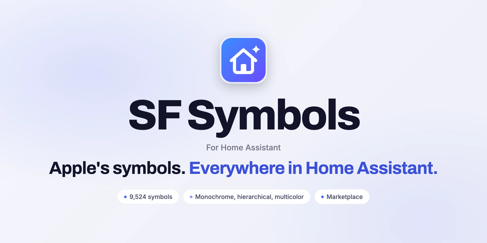

<div align="center">

<picture>
  <source media="(prefers-color-scheme: dark)" srcset="docs/images/readme-title-dark.webp" />
  
</picture>

[](https://github.com/SH1FT-W/sf-symbols/releases/latest)
[](https://www.home-assistant.io)
[](https://hacs.xyz)

<a href="https://sh1ft-w.github.io/sf-symbols"><b>Website</b></a>&emsp;<a href="#install">Install</a>&emsp;<a href="#set-up">Set up</a>&emsp;<a href="#use">Use</a>&emsp;<a href="CHANGELOG.md">Changelog</a>

</div>

<br/>

Apple's SF Symbols as icons everywhere in Home Assistant: **9,524 symbols of SF Symbols 27.0**, in monochrome, hierarchical and multicolor, with an icon picker that also understands German smart-home words. It replaces [Cupertino Icons](https://github.com/menahishayan/HomeAssistant-Cupertino-Icons) without changing any dashboard, entity or Casora setting.

The symbol data is generated on a Mac from Apple's SF Symbols app and belongs to Apple. It is not covered by the MIT license of the code, and Apple's brand symbols are not included.

## `sf:` or `ios:`

|  | `sf:` | `ios:` |
|:--|:--|:--|
| Names | Apple's, e.g. `sf:lamp.floor` | Cupertino's, e.g. `ios:lamp-floor` |
| Symbols | all 9,524; renamed Apple symbols resolve through Apple's alias tables | every Cupertino Icons 5.0.1 name (6,945) |
| Frame | one square for all, like MDI, so symbols line up with MDI icons | tight, like Cupertino |
| Found in the picker by | name, Apple's keywords and categories, German terms | name |
| Variants `#hierarchical`, `#multicolor` | ✓ | ✓ |
| Best for | new icons | dashboards that already use Cupertino |

**New in 26.11:** a symbol browser in the sidebar. Search every symbol, switch between `sf:` and `ios:` and the variants, and click to copy the name. Every change is in the [changelog](CHANGELOG.md) (German).

<a id="install"></a>
## Install

SF Symbols is a custom repository. In **Settings > Marketplace** (called HACS before Home Assistant 2026.11) open the three-dot menu, choose **Custom repositories**, add `https://github.com/SH1FT-W/sf-symbols` with type **Integration**, install **SF Symbols** and restart Home Assistant.

<details>
<summary>Install by hand</summary>

1. Copy `custom_components/sf_symbols` into `/config/custom_components/`.
2. Restart Home Assistant.

</details>

<a id="set-up"></a>
## Set up

1. **Add the integration.** **Settings > Devices & services > Add integration > SF Symbols**, confirm.
2. **Reload the browser tab.** If icons stay empty, reload a second time; the browser may still have the old page cached.
3. **Remove Cupertino Icons** when the repair notice asks. Until then `ios:` keeps working, but the variants only work once Cupertino Icons is gone, because its own module still draws those suffixes its way.

<a id="use"></a>
## Use

| Where | What |
|:--|:--|
| Any icon field | `sf:` or `ios:` names, chosen in the icon picker. Multi-word searches work in natural order ("floor lamp" finds `lamp.floor`), German words too ("Stehlampe", "Rollladen", "Heizung", "Steckdose"). |
| `#hierarchical` (`#h`), `#multicolor` (`#m`) | Appended to a name, e.g. `sf:cloud.sun.fill#multicolor`. 6,440 symbols have hierarchical layers, 2,749 multicolor; the rest stay monochrome. Cupertino's `#color`, `#invert` and `#fullcolor` draw monochrome, as before. |
| Sidebar: **SF Symbols** | The symbol browser, for administrators. Follows the light and dark theme and works on phones. Turn it off under **Configure** with *Show symbol browser in the sidebar*; icons keep working. |
| CSS variable `--sf-symbols-white` | White parts of multicolor symbols use the text colour so they stay visible in light themes. Set `#ffffff` for Apple's white. |

```yaml
type: tile
entity: weather.home
icon: sf:cloud.sun.fill#multicolor
```

## Good to know

- The picker lists every symbol twice (`ios:` and `sf:`), because Home Assistant shows every icon set.
- Hierarchical and multicolor colours come from a small hook into Home Assistant's `ha-svg-icon`. If a frontend update breaks it, the icons fall back to Home Assistant's own two-tone rendering.
- Variable values (e.g. `wifi` at 50 %), animations and gradients are not supported. The image inside `apple.writing.tools` is left out.
- The symbol data is only served with a Home Assistant login. On the login page or with an expired session icons stay empty until you are logged in.

<details>
<summary>Troubleshooting</summary>

- **Icons are empty.** Reload the browser, if needed twice because of the cache, and check that the integration is set up.
- **Symbol browser missing.** It is only shown to administrators and can be turned off in the options. After an update, reload the browser.
- **Copy does not work.** Browsers only allow the clipboard on HTTPS or through a fallback; if both are blocked, the message shows the name to type in.
- **Unknown name.** The browser console shows `SF Symbols: unknown icon …` once per name.
- **Variants stay monochrome.** Remove Cupertino Icons.
- **Diagnostics** (integration page, three dots, Download diagnostics) show the symbol set version, counts and the module URL.

</details>

<details>
<summary>Remove</summary>

1. Delete the integration under **Settings > Devices & services**.
2. Remove the custom repository in the Marketplace (or delete `/config/custom_components/sf_symbols`) and restart Home Assistant.

Icons using `sf:` or `ios:` are empty afterwards.

</details>

<details>
<summary>How it works</summary>

| Part | Does |
|:--|:--|
| Loader module | Public, because browsers load it before login. Fetches the symbol data with the logged-in user's token, also in the Companion app. |
| Symbol data | Outlines in 256 gzip chunks (about 20 KB each) plus `index.json` and `variants.json`, loaded on demand, cached for a year. Only with a login (401 otherwise). |
| Versioned URLs | The version is in every URL, so an update reaches every browser at once. |
| `tools/build_icons.py` | On macOS with the SF Symbols app: macOS draws every symbol in all three modes into vector PDFs (`tools/render_symbols.swift`), the script turns Apple's masks into plain SVG paths and adds names, aliases and keywords. About 25 seconds. |

`uv run tools/preview.py out.png lamp.floor house` renders a contact sheet for a visual check. A data update means running the script after a new SF Symbols app and bumping the version.

</details>

## License

The code (integration, frontend module, tools) is [MIT](LICENSE). The symbol data in `custom_components/sf_symbols/data/` is generated from Apple's SF Symbols app; SF Symbols are the property of Apple Inc. and subject to [Apple's license terms](https://developer.apple.com/sf-symbols/), not the MIT license.

<sub>This project is not affiliated with or endorsed by Apple Inc.</sub>
